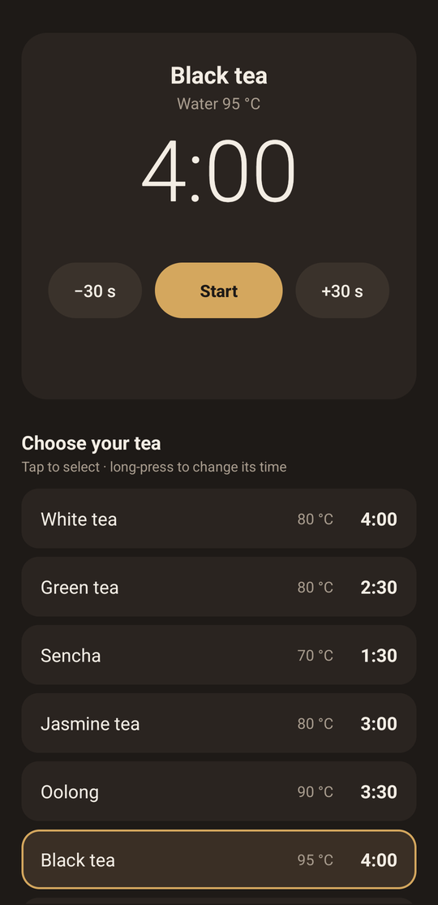
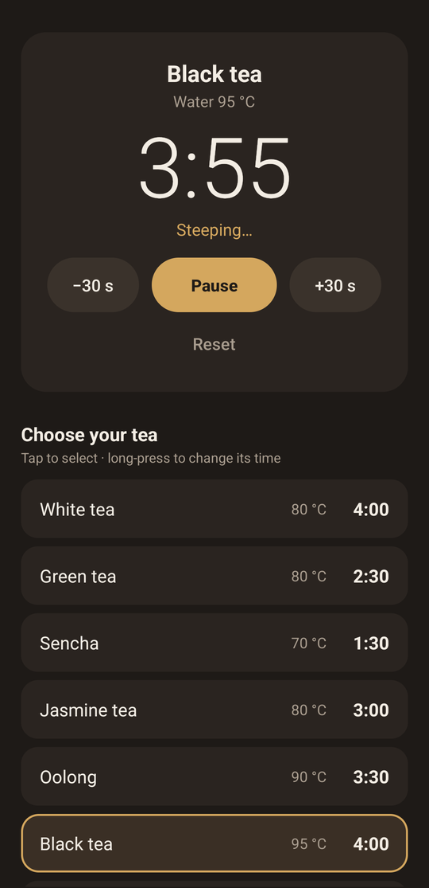

# Tea Timer

A small Android tea timer (Android 8.0+). English and Swedish UI, follows the phone's language.

  
  

## Features
- 11 teas with steep time and water temperature, plus a custom timer
- Long-press a tea to change its time (saved; "Default" restores it)
- −30 s / +30 s during or before a brew
- Keeps running when the app is closed: countdown in the notification, alert with sound and vibration when done
- Screen stays on while the timer runs

| Tea | Time | Water |
|---|---|---|
| White tea | 4:00 | 80 °C |
| Green tea | 2:30 | 80 °C |
| Sencha | 1:30 | 70 °C |
| Jasmine tea | 3:00 | 80 °C |
| Oolong | 3:30 | 90 °C |
| Black tea | 4:00 | 95 °C |
| Earl Grey | 4:00 | 95 °C |
| Darjeeling | 3:00 | 90 °C |
| Pu-erh | 4:00 | 95 °C |
| Rooibos | 6:00 | 100 °C |
| Herbal tea | 6:00 | 100 °C |

Defaults live in `app/src/main/java/se/jonsolberg/teatimer/Tea.java`.

## Download

**[Download the latest APK](https://github.com/jonsolberg/tea-timer/releases/latest/download/TeaTimer.apk)** · [all releases](https://github.com/jonsolberg/tea-timer/releases)

## Building the APK

**Android Studio:** open this folder, let it sync, then *Build → Build App Bundle(s) / APK(s) → Build APK(s)*.
The APK ends up in `app/build/outputs/apk/debug/`.

**GitHub (no Android Studio needed):** push this folder to a GitHub repository. The included workflow
(`.github/workflows/build.yml`) builds the APK on every push. Open the run under the *Actions* tab and
download the `tea-timer-apk` artifact, unzip it and install the APK on the phone (allow installing from
unknown sources when asked).

Note: debug builds made on different machines are signed with different keys, so to install a build from
a different machine over an existing install you may need to uninstall the old one first.

## License

Copyright © 2026 Jon Solberg

This program is free software: you can redistribute it and/or modify it under the terms of the
GNU General Public License as published by the Free Software Foundation, either version 3 of the
License, or (at your option) any later version.

This program is distributed in the hope that it will be useful, but WITHOUT ANY WARRANTY; without
even the implied warranty of MERCHANTABILITY or FITNESS FOR A PARTICULAR PURPOSE. See the
[GNU General Public License](LICENSE) for more details.
